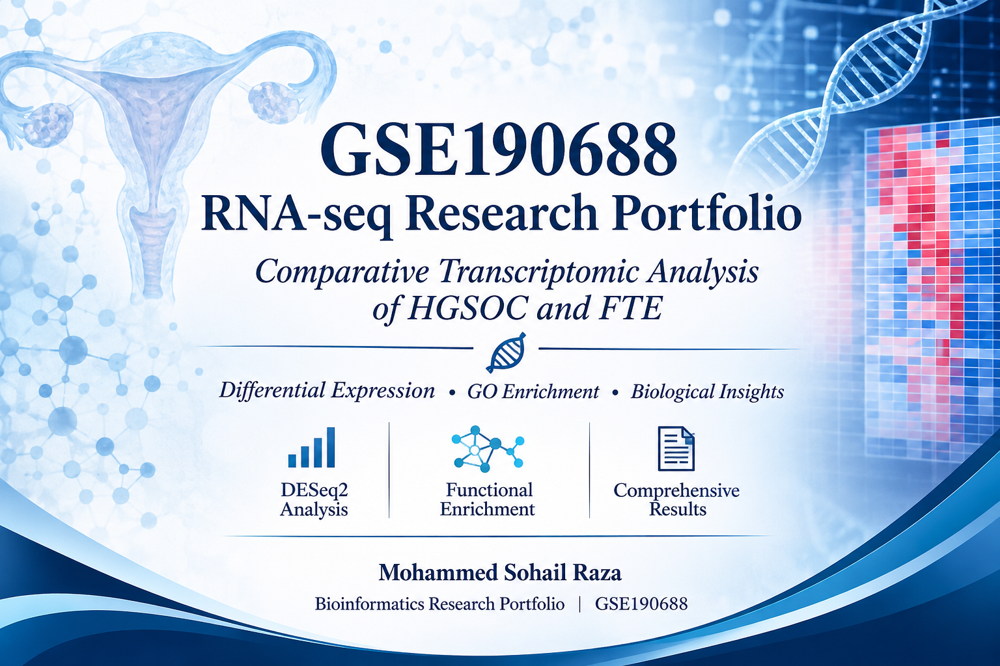
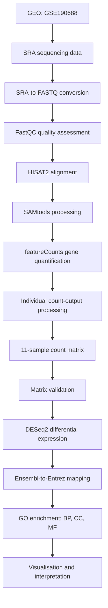

# GSE190688: RNA-seq Analysis of High-Grade Serous Ovarian Cancer

Researcher: Mohammed Sohail Raza
Collaborating team: Micrylis Biotech
Dataset: [GSE190688 — NCBI GEO](https://www.ncbi.nlm.nih.gov/geo/query/acc.cgi?acc=GSE190688)

## Project overview

This project investigates gene-expression differences between high-grade serous ovarian cancer (HGSOC) and fallopian tube epithelial (FTE) samples using publicly available RNA-sequencing data from GEO accession GSE190688.

The dataset comprises 11 samples:

- 6 HGSOC samples
- 5 FTE samples

The project includes RNA-seq quality-control review, count-matrix processing and validation, differential gene-expression analysis, and Gene Ontology (GO) enrichment analysis.

## Research objectives

- Examine gene-expression differences between HGSOC and FTE.
- Identify significantly differentially expressed genes.
- Investigate enriched biological processes, cellular components, and molecular functions.
- Explore biological patterns that may help guide further ovarian cancer research.

## Workflow



## Dataset and sample information

| Group | Number of samples |
|---|---:|
| HGSOC | 6 |
| FTE | 5 |
| Total | 11 |

The sample-to-accession mapping was checked against GEO metadata.

Reference genome: GRCh38
Annotation: Ensembl GRCh38 release 84

## Quality control

FastQC was performed on both paired-end FASTQ files for the assigned sample SRR17199566.

The reports include:

- Basic statistics
- Per-base sequence quality
- Sequence quality scores
- GC-content distribution
- Sequence duplication
- Adapter-content assessment

FastQC reports for SRR17199566 were published separately in the [GSE190688 FastQC Reports repository](https://github.com/samruddhii343/GSE190688-FastQC-Reports).

## Count matrix processing and validation

Individual sample-level featureCounts outputs from the collaborative workflow were processed and extracted to compile the combined gene-count matrix.

The resulting matrix was checked for:

- Expected sample identifiers and ordering
- Duplicate or missing gene identifiers
- Non-negative integer count values
- Consistency with the corresponding individual featureCounts outputs

The combined matrix contains 60,675 gene rows and 11 sample columns.

All 11 sample columns were validated against their corresponding individual outputs after accounting for a trailing carriage-return character in one file.

See "COUNT_MATRIX_VALIDATION.md" for details.

## Differential gene-expression analysis

DESeq2 was used to compare HGSOC against FTE.

Design formula: `~ condition`

Reference condition: FTE

Filtering criterion:

`rowSums(count_matrix >= 10) >= 2`

Significance threshold: Adjusted p-value < 0.05 using the Benjamini–Hochberg method.

### Summary of results

| Metric | Result |
|---|---:|
| Input genes | 60,675 |
| Genes retained after filtering | 24,746 |
| Genes with non-NA adjusted p-values | 24,259 |
| Significant DEGs | 9,867 |
| Higher in HGSOC | 5,573 |
| Higher in FTE | 4,294 |
| Significant DEGs with absolute log2 fold change ≥ 1 | 8,664 |

The analysis generated differential-expression result tables, normalized counts, and visualisations including PCA, volcano, MA, dispersion, and heatmap plots.

## Gene Ontology enrichment analysis

GO enrichment was performed separately for genes upregulated in HGSOC and genes upregulated in FTE.

The three GO categories examined were:

- Biological Process (BP)
- Cellular Component (CC)
- Molecular Function (MF)

### Enrichment results

| GO category | HGSOC-up | FTE-up |
|---|---:|---:|
| Biological Process | 121 | 116 |
| Cellular Component | 23 | 46 |
| Molecular Function | 20 | 13 |

The analysis used `clusterProfiler` and `org.Hs.eg.db`, with:

- Organism database: `org.Hs.eg.db`
- Identifier type: "ENTREZID"
- Multiple-testing correction: Benjamini–Hochberg
- p-value cutoff: 0.05
- q-value cutoff: 0.2
- Custom background: mapped Entrez identifiers from the DESeq2 gene set

Enrichment patterns included chromosome segregation and nuclear chromosome segregation among HGSOC-upregulated genes, and cilium organisation and cilium movement among FTE-upregulated genes.

The GO result tables and visualisations are available in `enrichment_analysis/`.

Mapping note: Ensembl identifiers were mapped to Entrez identifiers using `AnnotationDbi::mapIds()` with `multiVals = "first"`. Unmapped identifiers and multiple Ensembl-to-Entrez assignments are documented in the validation file.

See `enrichment_analysis/ENRICHMENT_VALIDATION.md`.

## Individual contributions

Mohammed Sohail Raza

- Conducted literature review and an epidemiological study related to ovarian cancer.
- Converted SRA data to paired-end FASTQ files for assigned sample SRR17199566.
- Performed FastQC quality assessment for both paired-end files of the assigned sample.
- Processed and extracted individual sample-level featureCounts outputs.
- Validated and compiled the combined 11-sample gene-count matrix.
- Performed downstream DESeq2 differential-expression analysis.
- Conducted Ensembl-to-Entrez identifier mapping and GO enrichment analysis.
- Generated and reviewed differential-expression and GO visualisations.
- Interpreted the computational findings.

Micrylis Biotech

Acknowledgement for collaborative upstream RNA-seq processing across the 11 samples and provision of individual sample-level featureCounts outputs.

## Tools and software

- SRA Toolkit
- FastQC
- HISAT2
- SAMtools
- featureCounts / Subread
- R
- DESeq2
- clusterProfiler
- AnnotationDbi
- org.Hs.eg.db
- ggplot2

## Repository structure

```text
GSE190688/
├── README.md
├── .gitignore
├── COUNT_MATRIX_VALIDATION.md
├── GSE190688_DESeq2_analysis.R
├── counts/
│   └── GSE190688_gene_count_matrix.tsv
├── deseq2_results/
│   ├── HGSOC_vs_FTE_DESeq2_results.csv
│   ├── Significant_DEGs_padj_lt_0.05.csv
│   ├── DESeq2_summary.txt
│   └── [plots and additional result files]
├── enrichment_analysis/
│   ├── ENRICHMENT_VALIDATION.md
│   ├── Ensembl_to_Entrez_mapping.csv
│   ├── six GO enrichment result CSV files
│   ├── GO_plots/
│   └── gene_lists/
├── metadata/
│   └── sample_metadata.csv
└── qc/
    ├── SRR17199566_1_fastqc.html
    ├── SRR17199566_1_fastqc.zip
    ├── SRR17199566_2_fastqc.html
    └── SRR17199566_2_fastqc.zip
```

## Limitations

- The analysis includes 11 samples, with 6 HGSOC and 5 FTE samples.
- Findings are computational and have not been experimentally validated in this project.
- Identifier mapping can result in unmapped identifiers and ambiguous mappings.
- The analysis depends on the supplied collaborative upstream processing and individual count outputs; the complete upstream workflow has not been independently reproduced for all samples.
- GO enrichment findings should be interpreted as hypotheses for further investigation, not proof of biological mechanisms.

## Data availability

The original dataset is publicly available through [NCBI GEO: GSE190688](https://www.ncbi.nlm.nih.gov/geo/query/acc.cgi?acc=GSE190688).

Raw sequencing data are available through the linked SRA records. Raw sequencing files, reference genome files, and large intermediate files are intentionally excluded from this repository.

## Acknowledgements

I acknowledge Micrylis Biotech for its collaborative contribution to the upstream RNA-seq processing and the provision of individual sample-level featureCounts outputs.

This project was conducted as a computational research exercise using publicly available data. The interpretations and downstream analyses presented here are attributed to the contributions described above.
